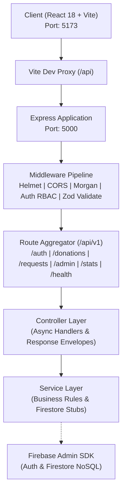

# ShareBite – Food Waste Management System
### Core Project Architecture & Integration Foundation

[](https://nodejs.org/)
[](https://expressjs.com/)
[](https://react.dev/)
[](https://vitejs.dev/)
[](LICENSE)

ShareBite is a distributed community food rescue platform designed to bridge the gap between food donors (restaurants, caterers, grocery stores) and food recipients (shelters, community pantries, individuals).

This repository contains the **Main Project Foundation**, integrating React (Vite) on the frontend, Node.js + Express on the backend, standardized data contracts, uniform API envelopes, Zod runtime validation, and pre-configured placeholder route handlers ready for team collaboration.

---

## 1. Architecture Topology



---

## 2. Directory Structure

```text
sharebite/
├── client/                               # Frontend Application (React + Vite)
│   ├── public/
│   ├── src/
│   │   ├── api/
│   │   │   ├── apiClient.js              # Centralized Axios client with token interceptor
│   │   │   └── endpoints.js              # Central API endpoint registry
│   │   ├── components/                   # Reusable UI components
│   │   │   └── README.md
│   │   ├── contracts/
│   │   │   └── models.js                 # Shared frontend models & factories
│   │   ├── pages/                        # Page-level route views
│   │   │   └── README.md
│   │   ├── App.jsx                       # Integration Status & Diagnostics Console
│   │   ├── index.css                     # Base styling
│   │   └── main.jsx                      # Vite React entry point
│   ├── .env.example                      # Client environment variables
│   ├── index.html
│   ├── package.json
│   └── vite.config.js                    # Vite configuration with /api backend proxy
├── server/                               # Backend API Architecture (Node.js + Express)
│   └── src/
│       ├── config/
│       │   ├── constants.js              # Shared Enums (Food, Request, Roles, Allergens)
│       │   ├── cors.js                   # Cross-Origin Resource Sharing configuration
│       │   ├── environment.js            # Environment variable validation & safe defaults
│       │   └── firebase.js               # Firebase Admin SDK stub & initialization hook
│       ├── controllers/
│       │   ├── admin.controller.js       # Admin user management & audit stubs
│       │   ├── auth.controller.js        # Auth session & profile stubs
│       │   ├── donation.controller.js    # Food listing CRUD stubs
│       │   ├── health.controller.js      # System health & uptime checker
│       │   ├── request.controller.js     # Food request lifecycle stubs
│       │   └── stats.controller.js       # Metrics & environmental impact stubs
│       ├── middleware/
│       │   ├── auth.middleware.js        # Token verification & Role-based Access Control
│       │   ├── errorHandler.js           # Central JSON error handler (catches 4xx & 5xx)
│       │   ├── notFoundHandler.js        # 404 Route Not Found handler
│       │   └── validate.middleware.js    # Zod schema request validation middleware
│       ├── routes/
│       │   ├── admin.routes.js           # /api/admin routes
│       │   ├── auth.routes.js            # /api/auth routes
│       │   ├── donation.routes.js        # /api/donations routes
│       │   ├── health.routes.js          # /api/health route
│       │   ├── index.js                  # Central API route aggregator
│       │   ├── request.routes.js         # /api/requests routes
│       │   └── stats.routes.js           # /api/stats routes
│       ├── services/
│       │   ├── admin.service.js          # Admin queries service stub
│       │   ├── auth.service.js           # Firebase Auth & user profile service stub
│       │   ├── donation.service.js       # Food donation Firestore service stub
│       │   ├── request.service.js        # Food request matching service stub
│       │   └── stats.service.js          # Impact & platform analytics service stub
│       ├── utils/
│       │   ├── ApiError.js               # Custom standard HTTP error class
│       │   ├── ApiResponse.js            # Standardized JSON response envelope
│       │   ├── asyncHandler.js           # Higher-order async controller wrapper
│       │   └── logger.js                 # Timestamped console logging utility
│       ├── validators/
│       │   ├── food.validator.js         # Zod schemas for food donation contracts
│       │   ├── index.js                  # Validator re-exports
│       │   ├── request.validator.js      # Zod schemas for food request contracts
│       │   └── user.validator.js         # Zod schemas for user profiles & authentication
│       ├── app.js                        # Express app creation & middleware wiring
│       └── server.js                     # HTTP server entry point & graceful shutdown
│   ├── .env.example                      # Server environment template
│   └── package.json
├── docs/                                 # Team Integration & Specifications Documentation
│   ├── API_CONTRACTS.md                  # Comprehensive API specification & curl examples
│   ├── DATABASE_SCHEMA.md                # Firestore NoSQL schemas, indexes & security rules
│   └── INTEGRATION_GUIDE.md              # Team guide: onboarding, boundaries & branch strategy
├── .env.example                          # Root environment template
├── .gitignore
├── package.json                          # Monorepo script orchestration
└── README.md
```

---

## 3. Architecture Modules Overview

ShareBite is organized into modular subsystems:

| Subsystem | Functional Scope | Primary Files |
|---|---|---|
| **Frontend & UI** | Responsive Views & Component System | `client/src/pages/*`, `client/src/components/*`, `client/src/App.jsx` |
| **Authentication & Database** | Firebase & Persistent Firestore Adapter | `server/src/config/firebase.js`, `server/src/middleware/auth.middleware.js`, `server/src/services/auth.service.js` |
| **Donations & Requests** | Uploads, Claim Workflow & Inventory Tracking | `server/src/services/donation.service.js`, `server/src/services/request.service.js`, `server/src/services/admin.service.js` |
| **Smart Logistics & Analytics** | Haversine Proximity & EPA WARM Models | `server/src/services/matching.service.js`, `server/src/services/stats.service.js`, `server/src/utils/` |

---

## 4. Shared Data Contracts

### Food Contract
```typescript
interface Food {
  foodId: string;
  foodName: string;
  quantity: string | number;
  category: 'Cooked Meals' | 'Produce' | 'Bakery' | 'Dairy' | 'Packaged Goods' | 'Beverages' | 'Other';
  donorId: string;
  location: { address: string; city: string; latitude?: number; longitude?: number; };
  preparedTime: string;       // ISO-8601
  pickupDeadline: string;     // ISO-8601
  status: 'AVAILABLE' | 'CLAIMED' | 'COMPLETED' | 'EXPIRED' | 'CANCELLED';
  allergens: string[];        // ['Dairy', 'Gluten', 'None', ...]
}
```

### Food Request Contract
```typescript
interface FoodRequest {
  requestId: string;
  foodId: string;
  receiverId: string;
  requestedQuantity: number;
  requestStatus: 'PENDING' | 'APPROVED' | 'REJECTED' | 'COLLECTED' | 'CANCELLED';
  createdAt: string;          // ISO-8601
}
```

### User Contract
```typescript
interface User {
  userId: string;
  name: string;
  email: string;
  role: 'DONOR' | 'RECEIVER' | 'VOLUNTEER' | 'ADMIN';
}
```

---

## 5. Quick Start Guide

### Step 1: Install Dependencies
From the repository root:
```bash
# Install root orchestration tools
npm install

# Install server dependencies
cd server && npm install

# Install client dependencies
cd ../client && npm install
```

### Step 2: Environment Setup
Copy the environment template files:
```bash
# Server environment
cp server/.env.example server/.env

# Client environment
cp client/.env.example client/.env
```

### Step 3: Start Development Servers
From the root directory:
```bash
# Starts both Express API (Port 5000) and Vite Client (Port 5173) concurrently:
npm run dev
```

Or start them individually in separate terminals:
```bash
# Terminal 1 - Backend:
cd server
npm run dev

# Terminal 2 - Frontend:
cd client
npm run dev
```

Visit `http://localhost:5173` to view the **Integration Status & Diagnostics Console**.
Visit `http://localhost:5000/api/health` to view the backend health check.

---

## 6. Pre-configured API Endpoints Summary

| Method | Endpoint | Description | Auth Required |
|---|---|---|---|
| `GET` | `/api/health` | System health & service status | No |
| `POST` | `/api/auth/register` | Register a new user | No |
| `POST` | `/api/auth/login` | Exchange credentials for token | No |
| `GET` | `/api/auth/me` | Fetch active user profile | Yes (Bearer) |
| `GET` | `/api/donations` | List food listings (with category/city filters) | No |
| `GET` | `/api/donations/:foodId`| Get single donation details | No |
| `POST` | `/api/donations` | Create food listing | Yes (Bearer) |
| `PATCH` | `/api/donations/:foodId/status` | Update food status | Yes (Bearer) |
| `GET` | `/api/requests` | List food requests | Yes (Bearer) |
| `POST` | `/api/requests` | Submit food request | Yes (Bearer) |
| `PATCH` | `/api/requests/:requestId/status` | Approve/Reject/Collect request | Yes (Bearer) |
| `GET` | `/api/admin/users` | List all platform users | Yes (Admin) |
| `GET` | `/api/admin/audit-logs` | View platform audit trail | Yes (Admin) |
| `GET` | `/api/stats/overview` | Platform high-level metrics | No |
| `GET` | `/api/stats/impact` | CO2 and food diverted metrics | No |
